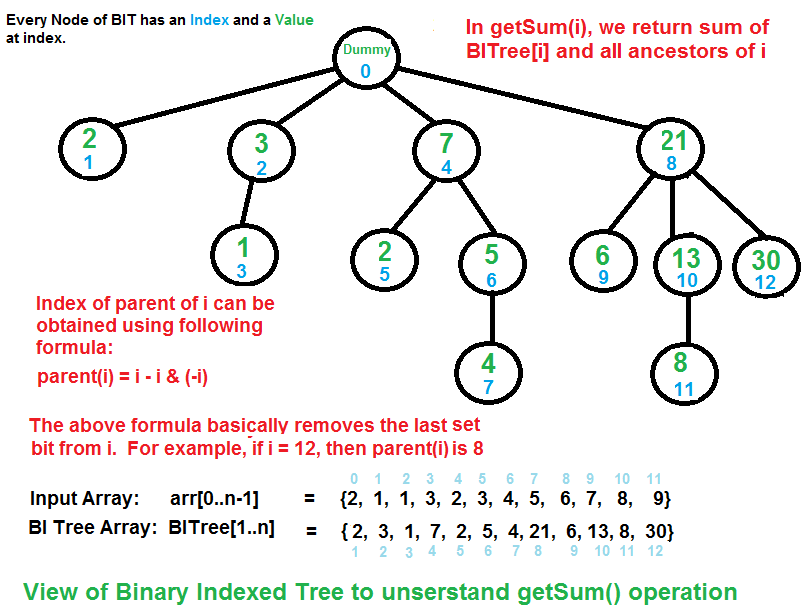

# Binary Indexed Tree (Fenwick Tree)

- Used for fixed input array and multiple queries of the following types:
    1. Prefix Operations (sum, product, XOR, OR, etc.)
    2. Update a value
    Both the queries are performed in O(logn) time.

- It is actually an array, but the concept is tree based 

- Heap and segment trees are binary tree data structure which means each node have at most 2 children but in Binary indexed tree nodes may have more than 2 children.

- Requires O(nlog(n)) preprocessing time (to build the binary tree we need to use the update operation which is O(logn) for one node) and θ(n) auxiliary space (as it is stored in a separate array).

- Segement trees can also perform the above two operations in O(logn) time but binary indexed tree comparatively takes less time and it is easy to implement also takes less space.

- Segment trees are bounded by the O(4logn) whereas binary indexed trees are upper bounded by O(logn) only. For auxiliary space in segment trees we reqire an array of size 4n whereas in binary indexed trees an array of size n+1.

- Binary indexed tree can also be used for range queries.  
    for ex:
    rangeSum(i,j) = prefixSum(j) - prefixSum(i-1)

- Binary Indexed trees cannot be applied to all  the questions that are solvable using segement trees. For ex. if we have to find the max/min element within a range, we cannot convert such queries into prefix sum format. But can only be solved using segment trees.

- Binary Indexed Tree (Prefix Sum):  
    

